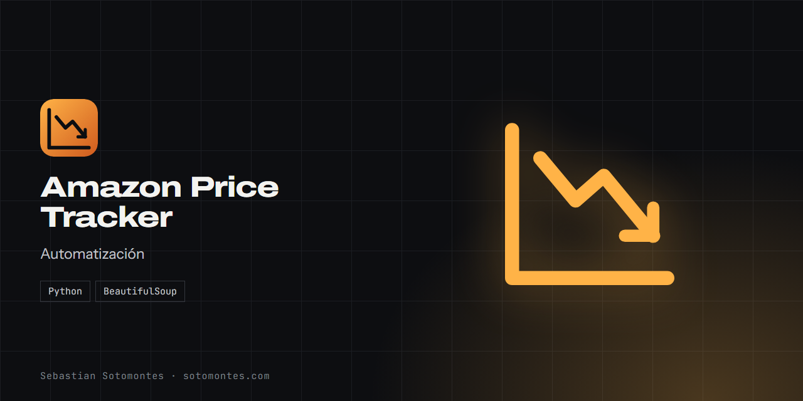
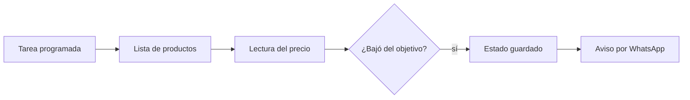

Vigila precios de Amazon y avisa por WhatsApp cuando un producto baja de tu precio objetivo.

<a href="https://sotomontes.com/#amazon-price-tracker"><b>Ver en sotomontes.com</b></a> · <a href="#cómo-se-usa">Cómo se usa</a> · <a href="#cómo-funciona-por-dentro">Cómo funciona</a> · <a href="#novedades">Novedades</a>

| Ficha técnica | |
|---|---|
| **Autor** | Sebastian Sotomontes |
| **Tipo** | Automatización |
| **Plataforma** | Windows, con Python |
| **Versión** | 1.0 |
| **Estado** | Funcional |
| **Stack** | Python · BeautifulSoup |
| **Código** | Privado. Esta página es solo una presentación. |

---

## Qué es

Vigila precios de Amazon y avisa por WhatsApp cuando un producto baja del precio que definiste.

## Novedades

- Aviso por WhatsApp sin repetir el mismo precio.

## Cómo se usa

1. Registra tu número en el servicio de mensajes.
2. Escribe en la lista las URL y el precio objetivo de cada producto.
3. Ejecútalo una vez para probar y revisa el registro.
4. Prográmalo cada 3 horas.

## Funciones

- **Vigilancia** de una lista de productos.
- **Aviso por WhatsApp** al bajar de tu precio objetivo.
- **Sin avisos repetidos**.
- **Ejecución programada** con el Programador de tareas.

## Detalles

- No conviene ejecutarlo más seguido que cada 2 o 3 horas.
- Si la tienda cambia su página, hay que actualizar los selectores.

## Cómo funciona por dentro

### Arquitectura

### Cómo funciona

Rota user-agents, prueba varios selectores de precio y espera entre productos. Guarda un estado para no repetir un aviso, y lo reinicia si el precio vuelve a subir.

---

© 2026 Sebastian Sotomontes. Todos los derechos reservados.
